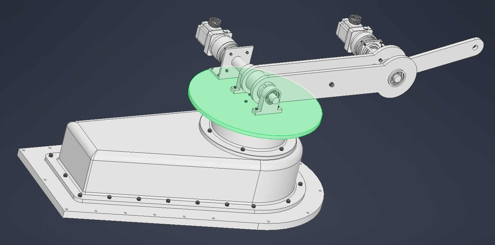

# Manipulator RRR – Autodesk Inventor

Model 3D manipulatora RRR wykonany w Autodesk Inventor.
Projekt obejmuje podstawę obrotową, konstrukcję ramion
oraz układy napędowe.

## Widok ogólny
Złożenie manipulatora z podstawą, obudową i ramionami.

## Konstrukcja ramion
Szczegóły przegubów, rozmieszczenia napędów i podparcia wałów.

.jpg>)

## Mechanizm obrotu podstawy
Widok silnika, przekładni zębatej i łożyskowania
po odsłonięciu obudowy.

.jpg>)
